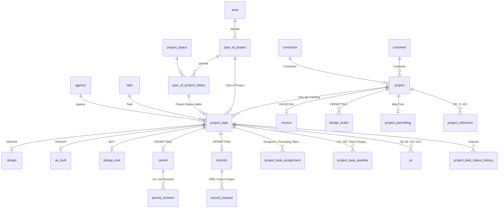

# Base `kmv` v4 — modelo, glosario y mapeo desde Smartsheet

Los nombres de tablas y campos siguen las columnas y picklists de Smartsheet, para que se reconozcan al verlos. Los comentarios del SQL están en español.

Validado contra la copia de **8. Crown Castle Fiber - Engineering Plan** (las 2010 filas), las hojas 2026 de Breezeline, Blue Stream, Lightpath, Hotwire y Others, la plantilla 2026 y Crown Castle 2025. Probado en PostgreSQL 16.

## 1. Áreas y tablas

| Área | Type of Project | Tablas |
|---|---|---|
| **Design** | `P` (KMV-P), `MISC` (KMV-Miscellaneous) | `design`, `as_built` |
| **MOT** (dentro de Design) | `MOT` (KMV-MOT) | `design_mot` (+ `permit` para el permiso de MOT de terceros) |
| **Permitting** | `LINE` (KMV-Line), `PERMIT` (KMV-Permit) | `permit`, `permit_revision`, `records`, `record_request`, `design_ticket`, `project_permitting`, `permit_requirement` |
| **Invoicing** | — (por proyecto) | `invoice` |
| **Core** | — | `project`, `project_reference`, `project_task`, `project_task_assignment`, `project_task_quantity`, `qc`, `sonde`, `project_task_status_history` |

- **KMV-Line** (926 filas): una por agencia; el permiso lo tramita el cliente u otros y KMV gestiona los records (97 % de los Record ID).
- **KMV-Permit** (226 filas): permiso tramitado por KMV (99 % de las fechas Permit Expires).

## 2. Diagrama

## 3. Convenciones de nombres

| Elemento | Regla | Ejemplo |
|---|---|---|
| Tablas y campos | Nombre de Smartsheet en `snake_case`, en inglés | "Purchase Orden" → `purchase_order` |
| Columnas de fecha | Nombre de Smartsheet + `_date` (si no lo trae ya) | "Permit Approved" → `permit_approved_date`; "Submitted Date" → `submitted_date` |
| Casillas (checkbox) | Nombre de Smartsheet tal cual | "Record Box" → `record_box`; "Invoice? GALP" → `invoice_galp` |
| Fecha y hora del sistema | `_at` | "Created" → `created_at`, "Modified" → `modified_at` |
| Clave de entidad | `<tabla>_id` | `project_task_id` |
| Catálogos | `code` estable en MAYÚSCULAS + `name` = texto de Smartsheet | `project_status.code = 'PERMIT_APPROVED'`, `name = 'Permit Approved'` |
| FK a catálogo | `<catálogo>_code` | `project_task.project_status_code` |
| Variantes de texto entre hojas | Tabla `<catálogo>_alias`, comparada con `normalize_text()` | `project_status_alias` |
| Restricciones | `<tabla>_<qué>_fk / _uq / _ck` | `project_task_status_fk` |

Excepciones, para que el nombre no confunda:
- "Record ID" (texto libre) → `records.record_id_text`, porque un campo `record_id` parece una clave.
- "Task" es el catálogo `task` (Jumper, Enterprise, PM LINE…). Cada fila de la hoja es un `project_task`.
- "LT" → `last_touched_date` (en la fila de encabezados de la hoja aparece como "Last Touched").

## 4. Glosario Smartsheet → base

### Proyecto (`project`, se toma de la fila KMV-P)

| Smartsheet | Campo |
|---|---|
| Tracking Project | `tracking_project` |
| Linked Tracking | `linked_tracking` (+ `linked_project_id` si existe en la base) |
| Customer | `customer_id` (vía `customer_alias`) |
| KMV/GALP (2025) / prefijo GALP-P | `kmv_galp` |
| Contractor | `contractor_id` (vía `contractor` / `contractor_alias`) |
| Construction Manager | `construction_manager_id` → `person` |
| Task (fila KMV-P) | `task_code` |
| CC System | `cc_system` (JDE/Oracle) o `us_state` (FLORIDA, GEORGIA… en Blue Stream) |
| Purchase Orden | `purchase_order` |
| Project Name | `project_name` + PD / S / WO / FPID en `project_reference` |
| Project Address, City, County | `project_address`, `city_id`, `county_id` |
| Date Received / Drawing Due Date | `date_received` / `drawing_due_date` |

### Fila (`project_task`)

| Smartsheet | Campo |
|---|---|
| Type of Project | `type_of_project_code` (vía `type_of_project_alias`) |
| Task | `task_code` (vía `task_alias`) |
| Project Status | `project_status_code` (vía `project_status_alias`) |
| Priority | `priority` RED / YELLOW / GREEN |
| Agency | `agency_id` (vía `agency` / `agency_alias`) |
| Obs / LT / Submitted Date / Due Date (2025) | `obs` / `last_touched_date` / `submitted_date` / `due_date` |
| Designer1, Designer2 (2025: Designer), Permitting Team, Engineer, Surveyor | `project_task_assignment` con `role_code` DESIGNER1, DESIGNER2, PERMITTING_TEAM, ENGINEER, SURVEYOR |
| Total Footage, UG, UG + Profile, ISP, Aerial, Custom MOT, TYPICAL MOT, Additional Site Survey, Survey Certified, Tone Locating, Sonde FTG, GPR, CAD Update, CADDING (+ 19 columnas solo de 2025) | `project_task_quantity` (`quantity_item.smartsheet_column` = nombre exacto) |
| QC IN / QC OUT | `qc.qc_in_date` / `qc.qc_out_date` |
| Sonde Request / Sonde Received | `sonde.sonde_request_date` / `sonde_received_date` |

### Design (`design`, `as_built`)

| Smartsheet | Campo |
|---|---|
| Survey Completed / Survey Check | `survey_completed_date` / `survey_check` |
| Design Completed / PM Approval Date | `design_completed_date` / `pm_approval_date` |
| Stamp & Seal / Stamp And Signatures # | `stamp_seal` / `stamp_and_signatures` |
| Prepare Packages (+ Request / QC / Completed) | `prepare_packages` / `prepare_packages_request_date` / `_qc_date` / `_completed_date` |
| Asbuilt received - Bore Log / As-Built Complete Date | `as_built.asbuilt_received_bore_log_date` / `as_built_complete_date` |
| Inspection Date / Inspection Pass | `inspection_date` / `inspection_pass_date` |

### MOT (`design_mot`)

Design MOT Request / QC / Completed → `design_mot_request_date` / `design_mot_qc_date` / `design_mot_completed_date` · Custom MOT → `custom_mot`

### Permitting

| Smartsheet | Campo |
|---|---|
| Design Ticket | `design_ticket.design_ticket` (uno por fila; solo uno `is_current`) |
| Mile Post # (2025) | `project_permitting.mile_post` |
| Records Status / Record Request / Record Received / Record Box / LT Records | `records.records_status_code` / `record_request_date` / `record_received_date` / `record_box` / `last_touched_records_date` |
| Record ID | `records.record_id_text` + una fila por solicitud en `record_request` (`prr_number`, `security_key`, `future_project_number`) |
| Permit # / Permit Fee / Bond? / Bond Fee Application | `permit.permit_number` / `permit_fee` / `bond` / `bond_fee_application` |
| Permit Coordinator Approved Date (QC) | `permit_coordinator_approved_date` |
| App Sent to Contractor / App Returned from Contractor | `app_sent_to_contractor_date` / `app_returned_from_contractor_date` |
| Runner Submitting / Runner Pick up | `runner_submitting_date` / `runner_pick_up_date` |
| Permit Approved / Permit Expires | `permit_approved_date` / `permit_expires_date` |
| 1st/2nd Revision Req, Completed, Permit 1st/2nd Resubmitted | `permit_revision` (`revision_number`, `revision_req_date`, `revision_completed_date`, `permit_resubmitted_date`) |

### Invoicing (`invoice`)

| Smartsheet | Campo |
|---|---|
| Invoice? GALP / Invoice? KMV / Customer invoice? (2025: Invoice? Crown) | `invoice_galp` / `invoice_kmv` / `customer_invoice` |
| Invoice Completed (Galp) / PM Approval Invoice Date | `invoice_completed_galp_date` / `pm_approval_invoice_date` |
| Invoice Sent / Invoice Paid | `invoice_sent_date` / `invoice_paid_date` |

### Columnas calculadas (vistas, no se guardan)

| Smartsheet | Vista.campo |
|---|---|
| Project # Days, QC # Days, PM Approval Days, Prepare Packages # Days, Sonde # Days, Record # Days, App Delay Days from Contractor, Permit # Days, Design MOT # Days, As-built # Days | `v_project_task_days.project_days`, `qc_days`, `pm_approval_days`, `prepare_packages_days`, `sonde_days`, `record_days`, `app_delay_days_from_contractor`, `permit_days`, `design_mot_days`, `as_built_days` |
| Invoice # Days / ¿pagada? | `v_invoice_status.invoice_days` / `is_paid` |
| Designers List, Correo Designer1/2 | se obtienen de `project_task_assignment` + `person` |

## 5. Project Status

- 71 estados con `code` estable y `name` = texto de Smartsheet sin el número. Están agrupados en `project_status_group` (Survey, Design, Packages, APP, Permit, Design MOT, Permit - MOT, As-Built, Close, Permit Extension, Ticket, Legacy), y cada grupo pertenece a un área.
- No se usa el número porque cambió entre años: en 2025 "3." era Permit y "7." Design MOT; en 2026 "3." es Packages y "5." Design MOT.
- `project_status_alias` contiene los **118 textos** de todas las hojas 2025–2026. Se verificó que todos resuelven.
- `type_of_project_status` define qué estados acepta cada Type of Project. La base rechaza "Permit Approved" en una fila KMV-P.
- "By others" y "On Hold" se mantienen como estados, con las marcas `is_by_others` / `is_on_hold`.
- El estado del proyecto se calcula en `v_project_summary`, con pendientes por área.

## 6. Limpieza antes de migrar

1. Crown Castle 2026: la fila 1 repite los encabezados y hay 12 filas sin Type of Project.
2. Basura de prueba: Task `sdsdsd`, PO `sdsad` (KMV-CC-26-002).
3. Agencias fuera del picklist (`Ticket Coordination`, `CANAL`) y duplicadas (`St Lucie County` / `Saint Lucie County`; `D.E.R.M` / `MDC - (DERM)` / `Miami (MDC - DERM)`).
4. Filas que la base rechazará por combinación tipo/estado: 2 KMV-Line con "7. As-Built (S&S)", 1 KMV-Line con "1. Survey Completed", 1 KMV-MOT con "2. Design Process" y 1 KMV-MOT con "4. Permit Process by others".
5. Record ID es texto libre con varias solicitudes por celda: se desglosa con un parser y se guarda el original en `record_id_text`.
6. Personas con variantes de nombre (`Carlos Lopez` / `Carlos López`): una `person` + `person_alias`.
7. Hotwire: el picklist dice `HC-` y el tracking `KMV-HW-` (ya resuelto con `customer.tracking_prefix`).
8. Crown Castle 2025: el picklist Customer dice **"CC-Comcast"** (el código CC es de Crown Castle). Hay que revisarlo a mano; no tiene alias a propósito.

## 7. Pendientes

- Confirmar que los Type of Project de 2025 `KMV-AB`, `KMV - RGB`, `KMV - UWS` y `KMV - RELOCATION` son filas principales (hoy se asignan a `P`).
- Los prefijos de contratista en Task (`DBE-`, `FN-`, `Mastec-`) hoy se asignan al servicio. Si importa para quién se diseñó, agregar un campo.
- Unidades de las cantidades marcadas con NULL.
- Facturación por cantidad × tarifa: agregar `invoice_line` y `customer_rate` cuando se decida.
